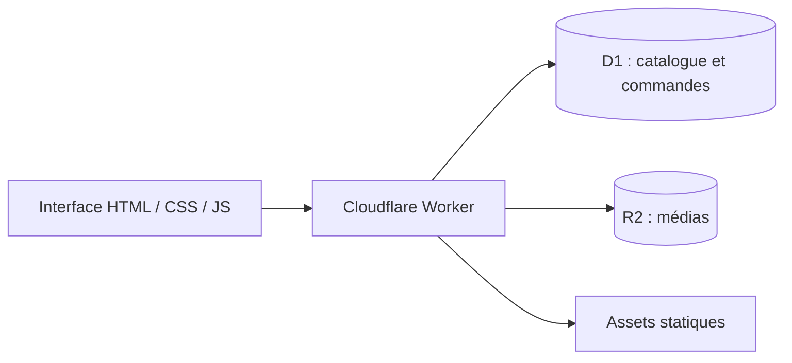

# Rahiq Arij · Boutique de miel

Un site e-commerce en arabe et en français pour présenter des miels, consulter le catalogue et passer commande. Il associe une interface légère à un backend Cloudflare Workers.

**HTML · CSS · JavaScript · Node.js · Cloudflare Workers · D1 · R2**

> Ce dépôt conserve une version du projet avant une refonte du hero. Le nom `rahiq-arij-backup` reflète cet historique ; il ne garantit pas que cette version soit celle du site actuellement en ligne.

## Fonctionnalités présentes

- Catalogue, fiches produit, panier et création de commandes.
- Interface arabe avec affichage RTL et traduction française.
- Espace administrateur pour les produits, les médias, les commandes et les statistiques de visites.
- Connexion administrateur avec cookie signé et contrôle de session.
- Stockage des données dans D1, médias dans R2 et contact WhatsApp.

## Architecture et fichiers



| Chemin | Rôle |
| --- | --- |
| `client/` | Scripts et traductions de l'interface |
| `server/worker.mjs` | API, authentification et accès aux données |
| `build.mjs` | Construction des fichiers statiques dans `dist/` |
| `preview-server.mjs` | Aperçu statique local |
| `tests/worker.test.mjs` | Tests du Worker avec base SQLite en mémoire |

## Aperçu local

Prérequis : **Node.js 22.13+** pour le module SQLite utilisé dans les tests. Aucune dépendance npm n'est à installer pour les commandes suivantes.

```powershell
git clone https://github.com/lahlouabdeslam6-rgb/rahiq-arij-backup.git
cd rahiq-arij-backup
node build.mjs
node preview-server.mjs
```

Ouvrir http://localhost:4173. Cet aperçu sert les fichiers statiques ; les routes API nécessitent un environnement Worker avec les bindings ci-dessous.

## Tests

```powershell
node --test tests/worker.test.mjs
```

Les tests utilisent des données de démonstration et des mocks pour D1, R2 et les assets. Ils ne se connectent pas à une base de production.

## Configuration du backend

| Nom | Usage |
| --- | --- |
| `DB` | Binding de la base D1 |
| `IMAGES` | Binding du bucket R2 |
| `ASSETS` | Binding des assets statiques |
| `ADMIN_USERNAME` | Nom de l'administrateur |
| `ADMIN_PASSWORD` | Mot de passe à définir dans l'environnement serveur |
| `SESSION_SECRET` | Secret de signature d'au moins 32 caractères |

Le fichier de hosting correspond au projet d'origine. Pour réutiliser le code sur une autre infrastructure, configurer ses propres ressources et secrets. Aucun déploiement n'est nécessaire pour lire le code ou lancer les tests.

**Auteur : [Ismail Lahlou](https://github.com/lahlouabdeslam6-rgb)** · [Portfolio](https://portfolio-ismail-lahlou.alvarezvcarlosr44274.chatgpt.site/)
